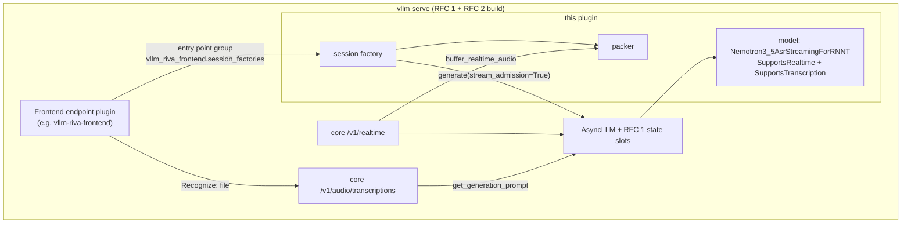

# High-Level Design: Nemotron 3.5 ASR streaming plugin for vLLM

## Problem

[`nvidia/nemotron-3.5-asr-streaming-0.6b`](https://huggingface.co/nvidia/nemotron-3.5-asr-streaming-0.6b)
is a cache-aware streaming RNN-T: each audio chunk advances encoder caches and decoder state that
the next chunk needs. vLLM serves requests that are independent once their prompt is processed, so
it has no place to keep that state between steps. As a result the checkpoint can be served in
vLLM only as whole files, bounded by the encoder's position limit and `max_model_len`, and not as
live streams.

Two proposals to vLLM core supply the missing pieces:
- **RFC 1** ([vllm#65543](https://github.com/vllm-project/vllm/issues/65543)): a scheduler-owned
  persistent-state primitive with one state slot per request
  ([vllm#67374](https://github.com/vllm-project/vllm/pull/67374)), and resumable stream admission
  on `AsyncLLM` ([vllm#67375](https://github.com/vllm-project/vllm/pull/67375), stacked on
  #67374). The two PRs supersede the earlier single draft PR #65544.
- **RFC 2** ([vllm#65545](https://github.com/vllm-project/vllm/issues/65545), draft PR
  [#65546](https://github.com/vllm-project/vllm/pull/65546)): lifecycle hooks for endpoint plugins,
  so a protocol frontend such as a Riva-compatible gRPC API can run inside `vllm serve`.

This plugin is the model on top of those primitives. It lets one `vllm serve` process serve this
checkpoint as live streams and as complete files, with no model-side length limit (core's `max_model_len` bounds a file until streamed file intake lands), through every API surface, with no
model code in vLLM itself.

## Approach

### 1. One stateful model serving every surface

The plugin registers the model as a vLLM general plugin. The model keeps its encoder caches and
decoder state in an RFC 1 state slot, so the same transition serves:
- live streams: core's native `/v1/realtime`, and the frontend's gRPC `StreamingRecognize` and NIM
  WebSocket through the session factory (section 2);
- complete files: core's `POST /v1/audio/transcriptions` and the frontend's gRPC `Recognize`, via
  `SupportsTranscription`. A file is walked on its own state slot in bounded steps of at most one
  cadence chunk, so no file length is limited by the model and whole-file work per step is
  bounded; its effect on stream latency is measured by the mixed-load goal, not assumed.

### 2. A session factory for protocol frontends

Frontends built as RFC 2 endpoint plugins do not import this package. They discover a session
factory through the entry-point group `vllm_riva_frontend.session_factories` and use it through a
structural protocol: open a session at a cadence and locale, feed audio, flush for the final
transcript, abort, and release once the slot has retired. The factory owns every engine-facing
task it starts, so a frontend's drain and stop can reason about them. The factory uses the RFC 1
client path (`AsyncLLM.generate(..., stream_admission=True)`, `wait_stream_retired`), which
reports rejected inputs without ending the stream and tells the caller when a slot has retired.
Core's `/v1/realtime` drives the model as a streaming request without stream admission, so there a
rejected input ends the stream. The reference consumer is
[`pdtgct/vllm-riva-frontend`](https://github.com/pdtgct/vllm-riva-frontend).

### 3. One packer for audio

Streaming inputs reach the model as its own envelope: one carrier placeholder token plus one audio
row holding cadence-segmented 16 kHz float32 samples and their metadata. One packer builds that
envelope, and it serves both the session factory and the model's `buffer_realtime_audio` hook for
core's `/v1/realtime`, so the two streaming paths cannot segment audio differently.

## Target Users

- **Operators** running speech recognition on vLLM who need live streaming with low latency and
  many concurrent sessions per GPU, and complete-file transcription of long recordings, from one
  server and one set of weights.
- **Frontend authors** building protocol adapters (Riva gRPC, NIM WebSocket) as RFC 2 endpoint
  plugins, who need a session API with explicit lifecycle and failure semantics.
- **vLLM reviewers** assessing RFC 1 and RFC 2, for whom this plugin is the end-to-end consumer
  that exercises both.

## Goals

- A stock streaming client, talking to `vllm serve` with only installed plugins, receives interim
  and final transcripts for a live stream.
- Whole-file transcription equals the streaming transcript of the same audio under matched
  conditions: the same decoded samples, language conditioning, lookahead, endpoint policy
  and numerical settings.
- Files longer than 400 s transcribe correctly; the limits are the deployment's (core's audio
  decode limits, the frontend's body limit, `max_model_len`, host memory), not the model's.
- With one whole-file request in flight beside concurrent streams, the streams' p95 final latency
  stays within 10 % of the same run without it.
- Every claim in this repository's README names the acceptance tier it has met (Success Metrics).

## Non-Goals

- Running on released vLLM. The plugin needs the RFC 1 primitive; until it is released, the
  supported engine is a build of the RFC branches.
- A second decoding algorithm. There is no full-context or non-streaming decoder; complete files
  use the streaming transition.
- Translation, diarization, word timestamps or beam search.
- Owning the frontend's protocol code. Protocol adapters live in frontend packages; this plugin
  provides the model and the session factory.
- Changing the offline plugin
  ([`Sohaib-Ahmed21/vllm-nemotron-asr-plugin`](https://github.com/Sohaib-Ahmed21/vllm-nemotron-asr-plugin))
  or its architecture key.

## Tenets

- **Streams before files.** When whole-file work and live streams compete for step time or memory,
  lean toward stream latency. This is a lean, not a reservation guarantee.

## System Design

Components, each a leaf design under `docs/intent/`:

| Component | Owns |
| --- | --- |
| `registration` | the `vllm.general_plugins` entry point, the architecture key, the config parser (`--config-format nemotron_asr_streaming`) and post-override validation, engine-flag refusals, the enumerated model-adapter dependencies |
| `session` | the session factory and lease on the RFC 1 client path, the packer and its use by `buffer_realtime_audio`, transcript projection, the error contract |
| `transcription` | `SupportsTranscription`, the request guards in `get_generation_prompt`, and the model seams it adds: the whole-file row role, the request-owned host buffer and its cleanup when the request ends, the continuation token, at most one chunk per step |

The acoustic internals under `vllm_nemotron_asr_streaming/nemotron_asr/` (encoder, RNN-T decoder,
the CHUNK / FLUSH / EOU transition, precision policy) are documented by their module docstrings;
the leaf designs cite them where they depend on them.

### Constraints

- **Engine.** The plugin targets the model API of the RFC 1 PRs #67374 and #67375 and no
  earlier RFC 1 head; core keeps no compatibility interfaces for the superseded #65544 API. Two
  builds of upstream vLLM `main` are targets:
  - **Stage 1, the model alone** on core's `/v1/realtime` and `/v1/audio/transcriptions`:
    #67374, #67375, and the speech-to-text PRs #67144 and #67151 (Whole-file serving, below).
  - **Stage 2, with a frontend:** stage 1 plus RFC 2, #65546 and #67294.

  The README records the commits each acceptance tier was actually met on, and claims only the
  tiers met. Python `>=3.11,<3.15`. Synchronous scheduling, no prefix caching and eager execution
  of the outer runner are required. An unset `async_scheduling` is accepted, because core resolves
  it to off for a model that declares persistent state; the plugin refuses to start when any of
  these is explicitly requested otherwise.
- **Model-owned execution memory.** The model's own captured encoder and decoder graphs and
  their buffers must exist before core sizes state slots and the KV cache, so that core's memory
  profile counts them. The RFC 1 PRs provide no hook dedicated to this; the `registration` design
  settles where in the model's lifecycle they are created, using only the permitted model-adapter
  dependencies.
- **Engine surface.** Session operations use only `AsyncLLM` / `EngineClient` public and
  RFC-proposed calls, never `engine_core` or scheduler internals. The model adapter's own
  dependencies (model-state interface, state-slot bindings, scheduler output types) are an
  enumerated, permitted set kept in the `registration` design.
- **A served set of lookaheads.** The implementation's five geometries (80, 160, 320, 560 and
  1120 ms; right context 0, 1, 3, 6 and 13 frames) share one state layout, so the per-slot state
  page is the same at every lookahead. The checkpoint's card declares lookaheads 0, 3, 6 and 13,
  and a server serves that set unless the deployment overrides it; an override may also add the
  implemented 160 ms geometry (lookahead 1), which the card does not declare. A server declares the set it serves
  (`supported_num_lookahead_tokens`), warms execution for each, and each stream chooses its cadence
  from that set when it is admitted and keeps it for the stream's life. A cadence outside the
  served set is refused at admission. Whole files run at the server's default cadence (the
  configured `num_lookahead_tokens`, which must be in the served set); the `transcription` design
  settles whether a request may choose another. The reference frontend's streaming surfaces need
  the 560 ms cadence (lookahead 6), and it refuses to start against a server that does not serve
  it. The experimental native-burst mode requires the configured lookahead to be 1 (160 ms); it
  does not restrict the served set to that cadence.
- **Completeness.** A transcript is reported complete only after EOS following the final flush.
  A stream that ends any other way fails. A whole file whose request ends with `length` because
  it reached `max_model_len`, or with `error` or `abort` (for example a preempted slot), can still
  return partial text with HTTP 200 through core's transcription serving until core reports those
  endings as errors. #67144 reports an `error` or `abort` ending as an error (non-streaming: an
  error response; streaming: a terminal error event); a `length` ending still returns partial
  text with HTTP 200, so the operator sizes `max_model_len` for the longest file served. This
  plugin depends on neither behaviour.
- **Whole-file serving is self-contained on core's route, once core carries two request fields.**
  The model imposes no file-size limit; core's upload and decode settings belong to the operator.
  The model refuses beam search and any client completion limit as options that do not apply to
  audio transcription, from `use_beam_search` and `max_completion_tokens` on
  `SpeechToTextParams` (Request guards). #67151 adds those fields and is part of the stage 1
  build; on a core without them the guards are inactive and the README states the limits. The
  model drops its worst-case admission check: the only length bound is core's actual-token
  `max_model_len` stop, which the operator sizes; a file that reaches it ends with `length` and
  returns partial text with HTTP 200 (Completeness). On a core without #67151, beam search
  issues up to `n × max_model_len` engine requests (one per beam per pass) per upload, so the
  route is not to be exposed to untrusted clients on such a core. The model also refuses to
  start under a generation-config token limit or foreign EOS. Without a frontend, `max_num_seqs`
  bounds the files actively scheduled, not uploads: queued requests hold their decoded audio in
  the API server with no bound.
- **Distribution.** The vendored model modules keep their SPDX headers and contributor
  attribution. The repository carries `LICENSE` (Apache-2.0) and a `NOTICE` naming the source
  repository, branch and commit of the vendored code and listing the files changed here.

## Key Design Decisions

| Decision | Choice | Alternatives considered and why not |
| --- | --- | --- |
| Where model source evolves | This repository. The model was vendored from `pdtgct/vllm` branch `rfc1-5212-vllm` @ `43c0bed5bf`, recorded in `NOTICE`; all later model changes land here, and that branch's copy is superseded | Keep the core branch as source and carry a downstream patch set: every change made twice, on a branch outside any proposal. No vendored copy: needs a vLLM build carrying the model in-tree, which RFC 1 and RFC 2 do not propose |
| Architecture key | `Nemotron3_5AsrStreamingForRNNT`, selected through a registered config parser; the Hub card's `Nemotron3_5AsrForRNNT` stays the offline plugin's key | Register the card's key: zero-configuration serving, but it would override the offline plugin when both are installed and remove whole-file service from released-vLLM users. Consolidation onto one key is planned with the offline plugin's author (below) |
| Relationship to the offline plugin | Independent package now; planned merge with the offline plugin into one package under the card's key, choosing the implementation at startup by whether the engine provides the RFC 1 primitive | Replace the offline implementation outright: breaks released-vLLM users until RFC 1 ships. Keep two packages permanently: users must choose between two packages for one model |
| Complete files | This model's own stateful path (`SupportsTranscription`), at most one chunk per step | A full-file forward pass: stalls the batch and is bounded by encoder positions. Delegating files to the offline plugin: a second implementation on the same server and the same ~400 s bound |
| Core API | Only the model API of #67374 and #67375 (Pete, 2026-11-12); the plugin adapts to it | Ask core for compatibility interfaces with #65544's API: core would carry API that no proposal needs. Support both APIs in the plugin: two code paths for one model, and #65544 is superseded |
| Frontend coupling | Structural protocol plus an entry-point group owned by the frontend; neither package imports the other | A shared interface package: a third release to coordinate for a small protocol |

### Same model, two implementations

This plugin and the offline plugin serve the same checkpoint and weights; neither has a
full-context variant. The encoder is block-causal, which is why equal transcripts are the
*acceptance target* for a whole-file pass and a stream at the same lookahead under the matched
conditions in Goals. It is a target, not an established result: equivalence across the two
implementations (preprocessing, tail handling, numerical execution) is untested. The offline
plugin's vLLM fp32 output equalled the Transformers fp32 reference on the clips measured so far
(public AMI clips of 20 s to 134 s, one 10.9 s LibriSpeech clip, and a 293 s AMI concatenation
at `--max-model-len 5000`), which
makes it a useful independent reference at a matched lookahead within its supported length. The
implementations differ:

| | Offline plugin | This plugin (target design; installed-engine validation pending) |
| --- | --- | --- |
| Engine | released vLLM; Transformers modules | RFC 1 primitive (and RFC 2 for frontends); native vLLM implementation |
| Execution | one encoder pass over the whole file, per-request RNN-T decoder state; no live audio continuation | encoder caches and decoder state carried in a state slot from chunk to chunk |
| Live streaming (`/v1/realtime`, frontends) | no | designed for it |
| Whole-file length | encoder frames ≤ min(5000, `max_model_len`): files above about 164 s are refused at the default `max_model_len` of 2048, above about 400 s at 5000 | no model limit by design; one state slot walks the file in bounded steps |
| Lookahead | accepted by the model per request; its transcription API sets only the language, so the processor default applies | per stream, from the server's served set; whole files at the server's default |
| Engine settings | Model Runner V2, `--enforce-eager`, TP = PP = 1; no quantization or speculative decoding | synchronous scheduling, no prefix caching, eager outer runner |

## Success Metrics

Acceptance is tiered; a claim names the tier it has met.

1. **CPU conformance.** Unit and contract tests, including the frontend's seam conformance suite run
   against this plugin's real factory, pass without a GPU.
2. **Installed-engine cycle.** On the target engine with the plugin installed: plugin load →
   stream admitted → audio → final transcript → slot retired, for one and for concurrent sessions.
3. **Equivalence.** On public clips from 20 s to over 400 s, whole-file transcripts (core
   transcription route and `Recognize`) equal the streaming transcript, and at a matched lookahead
   equal the offline plugin's within its supported length.
4. **Mixed load.** The latency goal above holds in unprofiled serving measurements.

Falsification signals: any whole-file transcript that differs from streaming under matched
conditions; any request reported complete without EOS after the final flush; a slot or host buffer
that outlives its request's release; more files actively scheduled than `max_num_seqs`, or than a frontend's file cap if one runs.

## References

- RFC 1: [vllm#65543](https://github.com/vllm-project/vllm/issues/65543), PRs [#67374](https://github.com/vllm-project/vllm/pull/67374) (state lifetime) and [#67375](https://github.com/vllm-project/vllm/pull/67375) (stream admission); superseded draft [#65544](https://github.com/vllm-project/vllm/pull/65544)
- Speech-to-text core PRs: [#67144](https://github.com/vllm-project/vllm/pull/67144) (fail `error` and `abort` endings), [#67151](https://github.com/vllm-project/vllm/pull/67151) (request fields)
- RFC 2: [vllm#65545](https://github.com/vllm-project/vllm/issues/65545), PRs [#65546](https://github.com/vllm-project/vllm/pull/65546) and [#67294](https://github.com/vllm-project/vllm/pull/67294) (readiness and draining)
- Model card: [nvidia/nemotron-3.5-asr-streaming-0.6b](https://huggingface.co/nvidia/nemotron-3.5-asr-streaming-0.6b)
- Offline plugin: [Sohaib-Ahmed21/vllm-nemotron-asr-plugin](https://github.com/Sohaib-Ahmed21/vllm-nemotron-asr-plugin); its vLLM PR [vllm#59827](https://github.com/vllm-project/vllm/pull/59827)
- Frontend: [pdtgct/vllm-riva-frontend](https://github.com/pdtgct/vllm-riva-frontend)
- Feature request: [vllm#47455](https://github.com/vllm-project/vllm/issues/47455)
