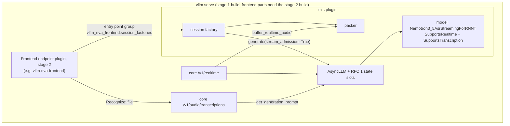

# High-Level Design: Nemotron 3.5 ASR streaming plugin for vLLM

## Problem

[`nvidia/nemotron-3.5-asr-streaming-0.6b`](https://huggingface.co/nvidia/nemotron-3.5-asr-streaming-0.6b)
is a cache-aware streaming RNN-T: each audio chunk advances encoder caches and decoder state that
the next chunk needs. vLLM serves requests that are independent once their prompt is processed, so
it has no place to keep that state between steps. As a result the checkpoint can be served in
vLLM only as whole files, bounded by the encoder's position limit and `max_model_len`, and not as
live streams.

Two proposals to vLLM core supply the missing pieces:
- **RFC 1** ([vllm#65543](https://github.com/vllm-project/vllm/issues/65543)): a scheduler-owned
  persistent-state primitive with one state slot per request
  ([vllm#67374](https://github.com/vllm-project/vllm/pull/67374)), and resumable stream admission
  on `AsyncLLM` ([vllm#67375](https://github.com/vllm-project/vllm/pull/67375), stacked on
  #67374). A third PR, [vllm#67583](https://github.com/vllm-project/vllm/pull/67583) (stacked on
  #67375), adds model-state hooks: execution-memory preparation, post-warmup and shutdown hooks,
  and a model-state CUDA graph capture hook that runs while the outer runner's `cudagraph_mode`
  is NONE. The three PRs supersede the earlier single draft PR #65544.
- **RFC 2** ([vllm#65545](https://github.com/vllm-project/vllm/issues/65545), draft PR
  [#65546](https://github.com/vllm-project/vllm/pull/65546)): lifecycle hooks for endpoint plugins,
  so a protocol frontend such as a Riva-compatible gRPC API can run inside `vllm serve`.

This plugin is the model on top of those primitives. It lets one `vllm serve` process serve this
checkpoint as live streams and as complete files, with no model-side length limit (core's `max_model_len` bounds a file until streamed file intake lands), through every API surface, with no
model code in vLLM itself.

## Approach

### 1. One stateful model serving every surface

The plugin registers the model as a vLLM general plugin. The model keeps its encoder caches and
decoder state in an RFC 1 state slot, so the same transition serves:
- live streams: core's native `/v1/realtime`, and the frontend's gRPC `StreamingRecognize` and NIM
  WebSocket through the session factory (section 2);
- complete files: core's `POST /v1/audio/transcriptions` and the frontend's gRPC `Recognize`, via
  `SupportsTranscription`. A file is walked on its own state slot in bounded steps of at most one
  cadence chunk, so no file length is limited by the model and whole-file work per step is
  bounded; its effect on stream latency is measured by the mixed-load goal, not assumed.

### 2. A session factory for protocol frontends

Frontends built as RFC 2 endpoint plugins do not import this package. They discover a session
factory through the entry-point group `vllm_riva_frontend.session_factories` and use it through a
structural protocol: open a session at a cadence and locale, feed audio, flush for the final
transcript, abort, and release once the slot has retired. The factory owns every engine-facing
task it starts, so a frontend's drain and stop can reason about them. The factory uses the RFC 1
client path (`AsyncLLM.generate(..., stream_admission=True)`, `wait_stream_retired`), which
reports rejected inputs without ending the stream and tells the caller when a slot has retired.
Core's `/v1/realtime` drives the model as a streaming request without stream admission, so there a
rejected input ends the stream. The reference consumer is
[`pdtgct/vllm-riva-frontend`](https://github.com/pdtgct/vllm-riva-frontend).

### 3. One packer for audio

Streaming inputs reach the model as its own envelope: one carrier placeholder token plus one audio
row holding cadence-segmented 16 kHz float32 samples and their metadata. One packer builds that
envelope, and it serves both the session factory and the model's `buffer_realtime_audio` hook for
core's `/v1/realtime`, so the two streaming paths cannot segment audio differently.

### 4. Opt-in whole-step graph replay

A streaming step is one model-defined transaction over resident state slots: host validation of
the row plan, a device body (gathers, frontend, encoder, RNN-T decode, projection) and predicated
scatters back into the state pages. The encoder and decoder regions can already replay their own
CUDA graphs, yet the step stays bound by host dispatch between them: per-op dispatch, kernel
launches and allocator work. With the opt-in `transaction_graph_populations` option the model
replays the whole device body and its scatters as one CUDA graph per declared *cell* (an exact row
population and transaction kind at the one served geometry), so a covered step costs one upload,
one graph launch and the commit stage. Any step that no cell covers, or whose signature differs
from its cell's, runs the eager transaction, which is the reference, and is counted as a fallback.

The model captures these graphs through #67583's model-state capture hook, into core's graph pool
and on core's capture stream, first over core's profiling state pools so that core's graph-memory
estimate charges their memory before state pages are planned, then over the serving pools. The
plugin keeps no graph pool of its own. The option runs without `--enforce-eager` and is refused
with it, because core runs no capture hook under `--enforce-eager`; the outer runner still
captures nothing (`cudagraph_mode` NONE). The option serves exactly one geometry, 80 ms or
160 ms, and it is off by default.

## Target Users

- **Operators** running speech recognition on vLLM who need live streaming with low latency and
  many concurrent sessions per GPU, and complete-file transcription of long recordings, from one
  server and one set of weights.
- **Frontend authors** building protocol adapters (Riva gRPC, NIM WebSocket) as RFC 2 endpoint
  plugins, who need a session API with explicit lifecycle and failure semantics.
- **vLLM reviewers** assessing RFC 1 and RFC 2, for whom this plugin is the end-to-end consumer
  that exercises both.

## Goals

- A stock streaming client, talking to `vllm serve` with only installed plugins, receives interim
  and final transcripts for a live stream.
- Whole-file transcription equals the streaming transcript of the same audio under matched
  conditions: the same decoded samples, language conditioning, lookahead, endpoint policy
  and numerical settings.
- Files longer than 400 s transcribe correctly; the limits are the deployment's (core's audio
  decode limits, the frontend's body limit, `max_model_len`, host memory), not the model's.
- With one whole-file request in flight beside concurrent streams, the streams' p95 final latency
  stays within 10 % of the same run without it.
- With transaction graphs on, transcripts and resident state equal the eager transaction's bit for
  bit, and the served step is faster than with the option off by the threshold of Success
  Metrics, tier 5.
- Every claim in this repository's README names the acceptance tier it has met (Success Metrics).

## Non-Goals

- Running on released vLLM. The plugin needs the RFC 1 primitive; until it is released, the
  supported engines are the stage 1 and stage 2 builds of upstream `main` with the open PRs
  (Constraints).
- A second decoding algorithm. There is no full-context or non-streaming decoder; complete files
  use the streaming transition.
- Translation, diarization, word timestamps or beam search.
- Owning the frontend's protocol code. Protocol adapters live in frontend packages; this plugin
  provides the model and the session factory.
- Changing the offline plugin
  ([`Sohaib-Ahmed21/vllm-nemotron-asr-plugin`](https://github.com/Sohaib-Ahmed21/vllm-nemotron-asr-plugin))
  or its architecture key.
- Transaction graphs by default, at the 320, 560 or 1120 ms geometries, or at more than one
  geometry in one engine. Turning them on by default needs its own evidence and Pete's approval
  (the `transaction-graph` design states the gate).

## Tenets

- **Streams before files.** When whole-file work and live streams compete for step time or memory,
  lean toward stream latency. This is a lean, not a reservation guarantee.

## System Design

Components, each a leaf design under `docs/intent/`:

| Component | Owns |
| --- | --- |
| `registration` | the `vllm.general_plugins` entry point, the architecture key, the config parser (`--config-format nemotron_asr_streaming`) and post-override validation, engine-flag refusals, the enumerated model-adapter dependencies |
| `session` | the session factory and lease on the RFC 1 client path, the packer and its use by `buffer_realtime_audio`, transcript projection, the error contract |
| `transcription` | `SupportsTranscription`, the request guards in `get_generation_prompt`, and the model seams it adds: the whole-file row role, the request-owned host buffer and its cleanup when the request ends, the continuation token, at most one chunk per step |
| `transaction-graph` | the `transaction_graph_populations` option and its configuration checks, the cells and their classification, capture and release through #67583's model-state capture hook, replay and counted eager fallback, post-warmup verification, failure containment, graph-memory guards, the replay and fallback counters and the per-worker capture record, and the README's serve command for the option |

`transaction-graph` uses the other components; none of them calls into it. The other components
carry these responsibilities toward it:
- `registration` accepts both runner configurations of Constraints (Engine settings) and routes
  the model's own graph capture by configuration: under `--enforce-eager`, on the first
  profiling dummy step; under the hook configuration, in the capture hook. Its permitted
  model-adapter dependencies include the hook's modules.
- `transcription` states that no cell covers a whole-file row. A step with one runs eagerly and
  counts as a fallback, and file and stream rows can share a step, so while a file is in flight
  every step it shares with streams runs eagerly and those streams lose the saving.
- `session` keeps native burst off while the option is on.

The acoustic internals under `vllm_nemotron_asr_streaming/nemotron_asr/` (encoder, RNN-T decoder,
the CHUNK / FLUSH / EOU transition, precision policy) are documented by their module docstrings;
the leaf designs cite them where they depend on them.

### Constraints

- **Engine.** The plugin requires the state-lifetime and stream-admission API of the RFC 1 PRs
  #67374 and #67375 and no earlier RFC 1 head; core keeps no compatibility interfaces for the
  superseded #65544 API. Two builds of upstream vLLM `main` are targets:
  - **Stage 1, the model alone** on core's `/v1/realtime` and `/v1/audio/transcriptions`:
    #67374, #67375, and the speech-to-text PRs #67144 and #67151 (Whole-file serving, below).
  - **Stage 2, with a frontend:** stage 1 plus RFC 2 (#65546 and #67294) and a frontend
    endpoint plugin such as `vllm-riva-frontend`.

  The model-state hooks of #67583 are an optional capability, detected at startup. On a core
  without them the outer runner must be eager (`--enforce-eager`) and every option that needs the
  capture hook is refused with a message naming the missing hook. Features that need the hook,
  transaction graphs among them, are qualified on **stage 1 plus #67583**. The README records the
  commits each acceptance tier was actually met on, and claims only the tiers met. Python
  `>=3.11,<3.15`.
- **Engine settings.** The resolved engine settings must be synchronous scheduling, no prefix
  caching and an outer runner that captures no CUDA graphs and compiles nothing, and the plugin
  refuses to start otherwise. Two configurations give such a runner:
  - `--enforce-eager`. Core then runs none of the three graph-capture hooks (on a core with
    #67583 it still calls `prepare_execution_memory`, `post_warmup` and `shutdown`), and the
    model captures its own encoder and decoder graphs on the first profiling dummy step.
    Transaction graphs are refused in this configuration.
  - The hook configuration: on a core with #67583, `cudagraph_mode` NONE with compilation off.
    Every graph the model runs, segment graphs and transaction graphs alike, is then captured in
    `capture_cudagraphs`, and none on the profiling dummy step. This configuration is accepted
    only when it selects at least one graph that the hook captures. With segment graphs alone it
    is an accepted configuration, and acceptance tiers 1 and 2 are claimed for it only once they
    have been met on it.

  Settings that core resolves to the required value for a model that declares persistent state
  (an unset `async_scheduling` or prefix-caching option) are accepted unset; the `registration`
  design states the rule for each setting.
- **Model-owned execution memory.** The model's retained execution memory (its own captured
  encoder and decoder graphs and their buffers) and the peak transient memory of its execution
  must be in place or exercised before core's memory profiling measures the budget that the state
  pool and the KV cache must fit. Core binds state slots only after it allocates the state pool
  and the KV cache. #67583 divides this between two hooks, and the model keeps them apart:
  long-lived working memory outside any graph is allocated in `prepare_execution_memory`, which
  every profiled budget counts; graphs captured through `capture_cudagraphs` are counted only by
  core's graph-memory estimate, which runs only with a profiled budget and the estimate enabled.
  Under `--enforce-eager` the `registration` design settles where the model captures its own
  graphs, using only the permitted model-adapter dependencies.
- **The hook's capture lifecycle.** With the graph-memory estimate running, core first captures
  over temporary state pools that have the serving page count, then releases that capture
  through `clear_cudagraphs` and plans the state pages, then rebinds the state over the serving
  pools and captures again. The model's profiling capture therefore captures the same graphs as
  its serving capture, or graphs with at least their memory, and the model keeps nothing derived
  from the profiling pools once `clear_cudagraphs` returns. Core locks the workspace after the
  serving capture, so all workspace-backed memory is sized by the time that capture returns.
- **Graph memory is charged before capacity is fixed.** Transaction graphs bake in resident
  state-pool addresses and retain on the order of gigabytes (about 2 GB for nine cells in the
  prototype's measurement), far more than the segment graphs, so their memory must be in core's
  graph-memory estimate before the state pages are planned. The option is therefore refused
  whenever that estimate will not run: a fixed `kv_cache_memory_bytes`, the estimate disabled,
  or a platform without it. A refusal names the option and the setting that blocks it. A serving
  capture of transaction graphs with no profiling capture before it in the same worker fails
  startup, which also covers paths that configuration cannot predict. The CuMem allocator and
  sleep mode are already refused for every persistent-state model (core, and `registration`'s
  REG-ENG-003).
- **Engine surface.** Session operations use only `AsyncLLM` / `EngineClient` public and
  RFC-proposed calls, never `engine_core` or scheduler internals. The model adapter's own
  dependencies (model-state interface, state-slot bindings, scheduler output types) are an
  enumerated, permitted set kept in the `registration` design.
- **A served set of lookaheads.** The implementation's five geometries (80, 160, 320, 560 and
  1120 ms; right context 0, 1, 3, 6 and 13 frames) share one state layout, so the per-slot state
  page is the same at every lookahead. The checkpoint's card declares lookaheads 0, 3, 6 and 13,
  and a server serves that set unless the deployment overrides it; an override may also add the
  implemented 160 ms geometry (lookahead 1), which the card does not declare. A server declares the set it serves
  (`supported_num_lookahead_tokens`), warms execution for each, and each stream chooses its cadence
  from that set when it is admitted and keeps it for the stream's life. A cadence outside the
  served set is refused at admission. Whole files run at the server's default cadence (the
  configured `num_lookahead_tokens`, which must be in the served set); the `transcription` design
  settles whether a request may choose another. The reference frontend's streaming surfaces need
  the 560 ms cadence (lookahead 6), and it refuses to start against a server that does not serve
  it. The experimental native-burst mode requires the configured lookahead to be 1 (160 ms); it
  does not restrict the served set to that cadence. Transaction graphs do restrict it: with them
  on, the served set is exactly one geometry, lookahead 0 or 1 (80 or 160 ms), and native burst is
  off. Whole files then run at that geometry too, and the reference frontend, which needs 560 ms,
  does not start against such a server.
- **Completeness.** The model and the session factory treat a transcript as complete only after
  EOS following the final flush; a session that ends any other way fails. How core's own routes
  report a request that ends without EOS is core's behaviour, not the plugin's:
  - `/v1/realtime` ignores the finish reason and sends its final transcript event whenever
    generation ends, so a stream stopped by `length`, `error` or `abort` is reported done there.
  - On the transcription route, #67144 fails an `error` ending (non-streaming: an error response;
    streaming: an error event) and an `abort` ending (non-streaming: an error response;
    streaming: a final chunk with `finish_reason` `abort`). #67151 also fails a `length` ending
    caused by a server limit such as `max_model_len` (HTTP 422; streaming: an error event); since
    the model refuses client completion limits, every `length` ending is server-caused. On a
    core without these PRs such endings return partial text with HTTP 200.

  The plugin needs no core change for its own completeness rule; the stage 1 build includes
  #67144 and #67151 so that core's transcription route reports these endings.
- **Whole-file serving is self-contained on core's route, once core carries two request fields.**
  The model imposes no file-size limit; core's upload and decode settings belong to the operator.
  The model refuses beam search and any client completion limit as options that do not apply to
  audio transcription, from `use_beam_search` and `max_completion_tokens` on
  `SpeechToTextParams` (Request guards). #67151 adds those fields and is part of the stage 1
  build; on a core without them the guards are inactive and the README states the limits. The
  model drops its worst-case admission check: the only length bound is core's actual-token
  `max_model_len` stop, which the operator sizes; a file that reaches it fails with HTTP 422 on
  the stage 1 build (Completeness). On a core without #67151, beam search
  issues up to `n × max_model_len` engine requests (one per beam per pass) per upload, so the
  route is not to be exposed to untrusted clients on such a core. The model also refuses to
  start under a generation-config token limit or foreign EOS. Without a frontend, `max_num_seqs`
  bounds the files actively scheduled, not uploads: queued requests hold their decoded audio in
  the API server with no bound.
- **Distribution.** The vendored model modules keep their SPDX headers and contributor
  attribution. The repository carries `LICENSE` (Apache-2.0) and a `NOTICE` naming the source
  repository, branch and commit of the vendored code and listing the files changed here.

## Key Design Decisions

| Decision | Choice | Alternatives considered and why not |
| --- | --- | --- |
| Where model source evolves | This repository. The model was vendored from `pdtgct/vllm` branch `rfc1-5212-vllm` @ `43c0bed5bf`, recorded in `NOTICE`; all later model changes land here, and that branch's copy is superseded | Keep the core branch as source and carry a downstream patch set: every change made twice, on a branch outside any proposal. No vendored copy: needs a vLLM build carrying the model in-tree, which RFC 1 and RFC 2 do not propose |
| Architecture key | `Nemotron3_5AsrStreamingForRNNT`, selected through a registered config parser; the Hub card's `Nemotron3_5AsrForRNNT` stays the offline plugin's key | Register the card's key: zero-configuration serving, but it would override the offline plugin when both are installed and remove whole-file service from released-vLLM users. Consolidation onto one key is planned with the offline plugin's author (below) |
| Relationship to the offline plugin | Independent package now; planned merge with the offline plugin into one package under the card's key, choosing the implementation at startup by whether the engine provides the RFC 1 primitive | Replace the offline implementation outright: breaks released-vLLM users until RFC 1 ships. Keep two packages permanently: users must choose between two packages for one model |
| Complete files | This model's own stateful path (`SupportsTranscription`), at most one chunk per step | A full-file forward pass: stalls the batch and is bounded by encoder positions. Delegating files to the offline plugin: a second implementation on the same server and the same ~400 s bound |
| Core API | Only the model API of #67374 and #67375 (Pete, 2026-11-12), plus #67583's model-state hooks where the engine provides them; the plugin adapts to it | Ask core for compatibility interfaces with #65544's API: core would carry API that no proposal needs. Support both APIs in the plugin: two code paths for one model, and #65544 is superseded |
| Frontend coupling | Structural protocol plus an entry-point group owned by the frontend; neither package imports the other | A shared interface package: a third release to coordinate for a small protocol |
| Whole-step graph replay | A `transaction-graph` component in this repository, designed against #67583's model-state capture hook; the whole-transaction prototype at `pdtgct/vllm` `76376a0b36` (design `docs/design/nemotron_asr_transaction_graph.md`) is its measured evidence base, not its source | Import the prototype's modules from a vLLM build: they are in no core proposal, and core would carry model code. Transplant the prototype's patches: they target an in-tree copy of the model that has diverged from this one, and they carry a model-owned memory admission that the hook makes unnecessary |
| Graph-memory accounting | Core's graph-memory estimate, through the capture hook: the profiling capture over core's profiling state pools, then the serving capture into core's graph pool | A model-owned admission inventory and graph pool, retained through the profiling window and checked against the serving capture: core's estimate already measures the same graphs before planning, and the inventory needs its own fit rule and release check. Extrapolating from one captured cell: unsound, because cells do not share memory predictably |
| Served geometry under transaction graphs | Exactly one, 80 or 160 ms; the deployment configures it as both the served set and the default lookahead | Two geometries in one engine: more cells and memory with no mixed-geometry use yet. The 320 to 1120 ms geometries: no exactness or latency evidence for transactions that the replay accepts, and their step time is larger relative to host dispatch, so the expected saving is smaller |
| Steps with whole-file rows under transaction graphs | No cell covers them: they run eagerly and are counted | Classify file rows into cells: more cells and an exactness proof for the whole-file row role before any use needs it |

### Same model, two implementations

This plugin and the offline plugin serve the same checkpoint and weights; neither has a
full-context variant. The encoder is block-causal, which is why equal transcripts are the
*acceptance target* for a whole-file pass and a stream at the same lookahead under the matched
conditions in Goals. It is a target, not an established result: equivalence across the two
implementations (preprocessing, tail handling, numerical execution) is untested. The offline
plugin's vLLM fp32 output equalled the Transformers fp32 reference on the clips measured so far
(public AMI clips of 20 s to 134 s, one 10.9 s LibriSpeech clip, and a 293 s AMI concatenation
at `--max-model-len 5000`), which
makes it a useful independent reference at a matched lookahead within its supported length. The
implementations differ:

| | Offline plugin | This plugin (target design; installed-engine validation pending) |
| --- | --- | --- |
| Engine | released vLLM; Transformers modules | the stage 1 build (stage 2 for frontends), defined in Constraints; native vLLM implementation |
| Execution | one encoder pass over the whole file, per-request RNN-T decoder state; no live audio continuation | encoder caches and decoder state carried in a state slot from chunk to chunk |
| Live streaming (`/v1/realtime`, frontends) | no | designed for it |
| Whole-file length | encoder frames ≤ min(5000, `max_model_len`): files above about 164 s are refused at the default `max_model_len` of 2048, above about 400 s at 5000 | no model limit by design; one state slot walks the file in bounded steps |
| Lookahead | accepted by the model per request; its transcription API sets only the language, so the processor default applies | per stream, from the server's served set; whole files at the server's default |
| Engine settings | Model Runner V2, `--enforce-eager`, TP = PP = 1; no quantization or speculative decoding | synchronous scheduling, no prefix caching, an outer runner that captures no graphs (Constraints) |

## Success Metrics

Acceptance is tiered; a claim names the tier it has met and the build (stage 1 or stage 2) it was
met on. Stage 1 can meet every tier on core's routes. The CPU seam conformance suite needs only the
frontend package installed; served legs through a frontend (`Recognize`, the factory's stream
admission) need stage 2.

1. **CPU conformance.** Unit and contract tests, including the frontend's seam conformance suite run
   against this plugin's real factory, pass without a GPU.
2. **Installed-engine cycle.** On the target build with the plugin installed: plugin load →
   stream started → audio → final transcript → slot retired, for one and for concurrent sessions.
   On stage 1 the stream is a `/v1/realtime` session; on stage 2 it is also a factory session
   admitted with stream admission.
3. **Equivalence.** On public clips from 20 s to over 400 s, whole-file transcripts (core
   transcription route and `Recognize`) equal the streaming transcript, and at a matched lookahead
   equal the offline plugin's within its supported length.
4. **Mixed load.** The latency goal above holds in unprofiled serving measurements.
5. **Transaction graphs** (opt-in; met separately at 80 ms and at 160 ms, on the A40 at FP32,
   on stage 1 plus #67583):
   - the graphs are captured through #67583's capture hook with `cudagraph_mode` NONE, without
     `--enforce-eager` and without a model-owned graph pool;
   - "option-off" below means the same engine configuration with only the option changed: both
     runs use the hook configuration with the same segment-graph selection, which the
     `transaction-graph` design names;
   - on the qualification workload (test-clean streams at the served geometry, at populations
     the declared cells cover) every covered step's outputs and resident state equal the
     option-off transaction's bit for bit, the transcripts equal the option-off run's, and the
     run records zero fallbacks of any kind; steps that no cell covers (an undeclared
     population, a whole-file row) are tested separately, each with its expected fallback count
     and outputs equal to the option-off run's;
   - at populations 1, 31 and 63 the median option-on step is faster than the smaller of two
     bracketing option-off medians by at least the larger of 5 ms and the difference between
     those two medians, in each of two blocks; the `transaction-graph` design gives the
     procedure;
   - the single-stream admission demand measured through `AsyncLLM` in a multiprocess engine,
     from audio feed to slot park, improves by its own pre-registered rule, given in the
     `transaction-graph` design;
   - U(1), the per-step admission demand of one stream as compiled from a calibration run, is
     compiled with the option on and with it off, and the calibration records the option as part
     of the configuration it calibrated; the `transaction-graph` design owns this calibration run
     until the plugin has an admission-calibration component;
   - each cell's graph memory is measured and reported; an installed-engine check shows that
     core's estimate charged the profiling capture before the state pages were planned and that
     the serving capture retained no more; each guard in Constraints refuses its configuration;
   - TLA+ models of the capture lifecycle on the hook, kept in this repository, check without
     violations.

   Tier 4 is claimed with the option off. With it on, mixed load is measured and reported
   separately, because steps shared with a whole-file row run eagerly.

Falsification signals: any whole-file transcript that differs from streaming under matched
conditions; any session factory session, or core transcription request on either build, reported complete
without EOS after the final flush; a slot or host buffer
that outlives its request's release; more files actively scheduled than `max_num_seqs`, or than a frontend's file cap if one runs; with transaction graphs on, any covered step whose outputs or
resident state differ from the option-off transaction's, or any serving capture of transaction
graphs that ran without a profiling capture before it or retained more graph memory than that
profiling capture.

## References

- RFC 1: [vllm#65543](https://github.com/vllm-project/vllm/issues/65543), PRs [#67374](https://github.com/vllm-project/vllm/pull/67374) (state lifetime), [#67375](https://github.com/vllm-project/vllm/pull/67375) (stream admission) and [#67583](https://github.com/vllm-project/vllm/pull/67583) (model-state hooks and graph capture); superseded draft [#65544](https://github.com/vllm-project/vllm/pull/65544)
- Speech-to-text core PRs: [#67144](https://github.com/vllm-project/vllm/pull/67144) (fail `error` and `abort` endings), [#67151](https://github.com/vllm-project/vllm/pull/67151) (request fields; fail server-caused `length` endings)
- RFC 2: [vllm#65545](https://github.com/vllm-project/vllm/issues/65545), PRs [#65546](https://github.com/vllm-project/vllm/pull/65546) and [#67294](https://github.com/vllm-project/vllm/pull/67294) (readiness and draining)
- Model card: [nvidia/nemotron-3.5-asr-streaming-0.6b](https://huggingface.co/nvidia/nemotron-3.5-asr-streaming-0.6b)
- Offline plugin: [Sohaib-Ahmed21/vllm-nemotron-asr-plugin](https://github.com/Sohaib-Ahmed21/vllm-nemotron-asr-plugin); its vLLM PR [vllm#59827](https://github.com/vllm-project/vllm/pull/59827)
- Frontend: [pdtgct/vllm-riva-frontend](https://github.com/pdtgct/vllm-riva-frontend)
- Feature request: [vllm#47455](https://github.com/vllm-project/vllm/issues/47455)
