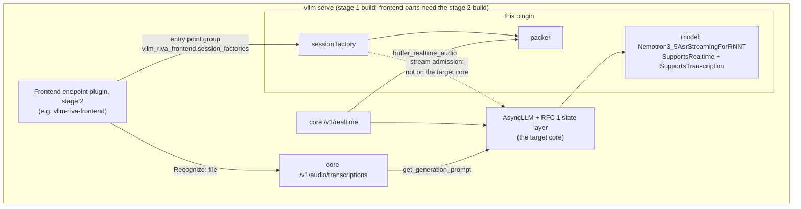

# High-Level Design: Nemotron 3.5 ASR streaming plugin for vLLM

## Problem

[`nvidia/nemotron-3.5-asr-streaming-0.6b`](https://huggingface.co/nvidia/nemotron-3.5-asr-streaming-0.6b)
is a cache-aware streaming RNN-T: each audio chunk advances encoder caches and decoder state that
the next chunk needs. vLLM serves requests that are independent once their prompt is processed, so
it has no place to keep that state between steps. As a result the checkpoint can be served in
vLLM only as whole files, bounded by the encoder's position limit and `max_model_len`, and not as
live streams.

Two proposals to vLLM core supply the missing pieces:
- **RFC 1** ([vllm#65543](https://github.com/vllm-project/vllm/issues/65543)): persistent state
  as a standard state layer. A model declares `SupportsPersistentState` and keeps the per-request
  state its tokens cannot rebuild in a `MambaSpec` KV-cache group whose manager configuration is
  not recomputable. Core never preempts such a request, keeps its page while the stream waits for
  its next input, and folds each streaming input into the same request. This plugin serves on that
  design's implementation, `pdtgct/vllm` branch `pstate-impl-20261122` at `ddf6db2ab8`, called
  *the target core* below. The target core also carries the model-state hooks of
  [vllm#67583](https://github.com/vllm-project/vllm/pull/67583): execution-memory preparation,
  post-warmup and shutdown hooks, and a model-state CUDA graph capture hook that core calls
  whatever the runner's `cudagraph_mode` is. It also carries a state-group layout accessor,
  `ModelState.state_group_layouts`, through which a model state's graphs address its state pages
  by block ID; core keeps a held page at its block ID and address until the request's terminal
  finish. The state layer replaces the state pool and stream
  admission of the draft PRs [vllm#67374](https://github.com/vllm-project/vllm/pull/67374) and
  [vllm#67375](https://github.com/vllm-project/vllm/pull/67375), which this plugin does not
  support.
- **RFC 2** ([vllm#65545](https://github.com/vllm-project/vllm/issues/65545), draft PR
  [#65546](https://github.com/vllm-project/vllm/pull/65546)): lifecycle hooks for endpoint plugins,
  so a protocol frontend such as a Riva-compatible gRPC API can run inside `vllm serve`.

This plugin is the model on top of those primitives. It lets one `vllm serve` process serve this
checkpoint as live streams and as complete files, with no model-side length limit (core's `max_model_len` bounds a file until streamed file intake lands), through every API surface, with no
model code in vLLM itself.

## Approach

### 1. One stateful model serving every surface

The plugin registers the model as a vLLM general plugin. The model keeps its encoder caches and
decoder state in one page of its RFC 1 state group, which core allocates per request, so the same
transition serves:
- live streams: core's native `/v1/realtime`, and, once the session factory runs on the target
  core (section 2), the frontend's gRPC `StreamingRecognize` and NIM WebSocket through it;
- complete files: core's `POST /v1/audio/transcriptions` and the frontend's gRPC `Recognize`, via
  `SupportsTranscription`. A file is walked on its own state page in bounded steps of at most one
  cadence chunk, so no file length is limited by the model and whole-file work per step is
  bounded; its effect on stream latency is measured by the mixed-load goal, not assumed.

### 2. A session factory for protocol frontends

Frontends built as RFC 2 endpoint plugins do not import this package. They discover a session
factory through the entry-point group `vllm_riva_frontend.session_factories` and use it through a
structural protocol: open a session at a locale (the server's geometry fixes the cadence), feed audio, flush for the final
transcript, abort, and release once the slot has retired. The factory owns every engine-facing
task it starts, so a frontend's drain and stop can reason about them. The reference consumer is
[`pdtgct/vllm-riva-frontend`](https://github.com/pdtgct/vllm-riva-frontend).

The factory is designed for a client path with explicit stream admission
(`AsyncLLM.generate(..., stream_admission=True)` and `wait_stream_retired`), which reports a
rejected input without ending the stream and tells the caller when a slot has retired. The target
core has neither call: `AsyncLLM.generate` admits a persistent-state stream automatically when it
is given an input generator, refuses admission with `StreamAdmissionError` before it reads any
input, and ends the stream with an error when it refuses a later input. On the target core
`create_session_factory` therefore refuses, and the session factory is not available; core's
`/v1/realtime` and transcription routes serve the model. Porting the factory to automatic
admission is a separate change (Future roadmap).

### 3. One packer for audio

Streaming inputs reach the model as its own envelope: one carrier placeholder token plus one audio
row holding cadence-segmented 16 kHz float32 samples and their metadata. One packer builds that
envelope, and it serves both the session factory and the model's `buffer_realtime_audio` hook for
core's `/v1/realtime`, so the two streaming paths cannot segment audio differently.

### 4. Opt-in whole-step graph replay

A streaming step is one model-defined transaction over resident state pages: host validation of
the row plan, a device body (gathers, frontend, encoder, RNN-T decode, projection) and predicated
scatters back into the state pages. Only a step's CHUNK rows run the encoder and decoder, grouped
by their exact count; its REPLAY and FLUSH rows (label drain, echo validation and the end step)
run only masked validation, projection and scatter. By default the encoder and decoder replay
their own *segment graphs* (section 5), yet the step stays bound by host dispatch around them:
per-op dispatch, kernel launches and allocator work. With the opt-in
`transaction_graph_populations` option the model also replays the rest of the device body and its
scatters from CUDA graphs. Each step splits by row kind: its CHUNK rows replay a *chunk graph*
captured at exactly their count, and its other rows replay an *echo graph* captured at exactly
their count, which runs no encoder. A step of one kind costs one upload, one graph launch and the
commit stage; a step with both kinds costs two launches under one reservation and one commit
stage. Whether a CHUNK row starts a fresh stream is a per-row mask inside the chunk graph, as is
whether a row belongs to a whole file, so freshness and files add no graphs. A *cell* is one
captured graph: its geometry, kind and exact row count. The option declares the step populations
the deployment expects, and the model captures a chunk cell and an echo cell at every count from 1
to the largest of them. A population above core's admission limit (`--max-num-active-seqs`, or
`max_num_seqs` when it is unset) can never occur, because core runs no more requests at once, so
the option refuses it. A step is covered only when every kind it
contains has a cell at its count (a 31-row step with 20 CHUNK rows needs the chunk cell at 20 and
the echo cell at 11); any other step, or one whose signature differs from its cells', runs wholly
as the option-off transaction, which is the reference, and is counted as a fallback. The host
validates the whole step, both signatures and the one reservation before the first launch, so a
launch or device failure after the first launch is worker-fatal, never a retry or a rollback; a
row that per-row validation rejects is a status bit with a masked scatter, as in the option-off
transaction. The masks select
among values the graph computes for every row: no value from a fresh row's recycled state page
reaches its outputs or its new state, as in the option-off transaction.

The model captures these graphs through #67583's model-state capture hook, into core's graph pool
and on core's capture stream: when core runs its graph-memory estimate, first over core's
minimal profiling KV cache so that the estimate charges their memory before state pages are planned,
and then, always, over the serving state pages. The
plugin keeps no graph pool of its own. The option runs without `--enforce-eager` and is refused
with it, because core runs no capture hook under `--enforce-eager`; the outer runner still
captures nothing (`cudagraph_mode` NONE). In its first release the option is offered at the
80 ms and 160 ms geometries, and it is off by default. The cells bake in state-page addresses,
which the model reads at capture from the target core's state-group layout accessor. On the
target core the option starts only under a *restricted startup*: synchronous scheduling
(`--no-async-scheduling`), explicit `-cc.cudagraph_mode none -cc.mode none`, and either
`--num-gpu-blocks-override` with at least `N + 1` blocks (`N` the largest declared population)
or `--kv-cache-memory-bytes`, both of
which turn core's extensible KV cache off. Every other startup with the option on is refused,
naming each unmet condition and its remedy. Without an explicit block count or budget, core's
minimal profiling KV cache holds too few state pages for the profiling capture (one block under
an explicit NONE), and the extensible KV cache backs only its first blocks at the serving capture
and grows without refreshing the layout; the restriction lifts when core closes both gaps and the
qualification covers the other settings (Future roadmap).

### 5. Graphed segments by default

By default the model runs the fastest segment execution measured on the earlier in-tree copy of
this model: the `eager-graphed` encoder, which captures the uncompiled encoder transition at every
exact CHUNK count from 1 to `max_num_seqs`, and the `dense-graphed` RNN-T decoder, captured at
padded population tiers. The encoder's first pointwise convolution runs with batch and frames
folded into one axis (`_stream_conv` in `vllm_nemotron_asr_streaming/nemotron_asr/encoder.py`)
in every arm. On that copy the
encoder's replay equalled its eager path bit for bit; the decoder arm's transcripts equalled the
eager arm's, which shows equal decisions, not bitwise equal decoder state. In a light A40 check of
this plugin under `--enforce-eager` at 320 ms and 64 rows, the graphed arms' transcripts equalled the eager arms' on 200
utterances, and median final latency fell from about 416 to 163 ms; the acceptance tiers qualify
the arms. The figures in
this section and in Key Design Decisions come from unpublished project measurements; the tier 2
and tier 5 results published with the plugin replace them.

The cost is graph memory and startup time. Encoder graphs grow faster than linearly with
`max_num_seqs`, one graph per CHUNK count. On an A40 at the 320 ms geometry under `--enforce-eager`, the default arms
retained about 1.1, 2.3 and 17.4 GiB of graph memory at `max_num_seqs` 32, 64 and 128, of which
the decoder's tiers were about 0.17 GiB at 64. During capture the device's memory in use, weights
included, peaked at 7.0, 18.3 and 44.4 GiB of the card's 45 GiB, so 128 leaves no headroom. Startup took about 41, 78 and 182 s,
against about 25 s for the eager arms. At 64 rows the 160 ms and 80 ms geometries retained 1.8
and 1.6 GiB. Under the hook configuration the retained memory, capture peak and startup time
are unmeasured. Graphs are captured only for the server's one geometry (Constraints). The README's
serve command therefore sets `--max-num-seqs` to a value the tier 2 measurement verified to fit
the A40 at the default geometry; until that measurement exists, the README may carry an interim
value, marked interim and unpublished, that qualifies neither runner configuration (the
`registration` design). The model logs the segment graphs' retained memory and capture
time, `max_num_seqs` and the geometry when it captures them: before core plans capacity under
`--enforce-eager` and when core runs its graph-memory estimate, and after it otherwise. A capture that cannot
allocate fails startup with the model's message, naming those figures and a complete remedy: a
smaller `max_num_seqs`, or the overrides that select the eager arms together with the runner
setting they need (`--enforce-eager`, with transaction graphs and CHUNK-bucket graphs off). A later capacity failure is core's
own, and the logged line is its diagnosis. The `registration` design may project the total from
the first captured counts and fail before capturing the rest. The eager arms (`eager` encoder, `dense-eager` decoder) remain selectable through
`--hf-overrides` and are the reference that the graphed arms are tested against.

## Target Users

- **Operators** running speech recognition on vLLM who need live streaming with low latency and
  many concurrent sessions per GPU, and complete-file transcription of long recordings, from one
  server and one set of weights.
- **Frontend authors** building protocol adapters (Riva gRPC, NIM WebSocket) as RFC 2 endpoint
  plugins, who need a session API with explicit lifecycle and failure semantics.
- **vLLM reviewers** assessing RFC 1 and RFC 2, for whom this plugin is the end-to-end consumer
  that exercises both.

## Goals

- A stock streaming client, talking to `vllm serve` with only installed plugins, receives interim
  and final transcripts for a live stream.
- Whole-file transcription equals the streaming transcript of the same audio under matched
  conditions: the same decoded samples, language conditioning, lookahead, endpoint policy
  and numerical settings.
- Files longer than 400 s transcribe correctly; the limits are the deployment's (core's audio
  decode limits, the frontend's body limit, `max_model_len`, host memory), not the model's.
- With one whole-file request in flight beside concurrent streams, the streams' p95 final latency
  stays within 10 % of the same run without it.
- With transaction graphs on, transcripts and resident state equal the option-off transaction's
  bit for bit, and the served step is faster than with the option off by the threshold of Success
  Metrics, tier 5.
- Transaction graphs become the default configuration. They ship opt-in until the default-on gate
  in the `transaction-graph` design passes and the maintainers approve the change; every design choice keeps
  that path open (cells keyed by geometry, no configuration that only an opt-in feature tolerates),
  and the restricted startup the option needs on the target core (Approach, section 4) is lifted
  before the option becomes the default.
  Once the option is on by default, `--enforce-eager` turns it off with a log line; an explicit
  request for it under `--enforce-eager` is refused.
- The default configuration runs graphed segments (Approach, section 5). Tiers 1 to 4 are
  qualified with the default segment arms, for each runner configuration claimed; tier 5 adds
  transaction graphs to them.
- With vLLM's batch-invariant mode on (`VLLM_BATCH_INVARIANT=1`) and transaction graphs off, a
  stream's final transcript does not depend on how many other streams share its steps (the
  `registration` design, REG-ENG-015). Outside that mode the FP32 kernels are not batch-invariant,
  so two runs under load can differ on a near-tie.
- Every acceptance claim in this repository is recorded in `docs/evidence.md` and names the tier it has met (Success Metrics); every figure the README summarizes names its tier, build and GPU or links that record.

## Non-Goals

- Running on released vLLM. The plugin needs RFC 1's state layer; until it is released, the
  supported engines are the stage 1 and stage 2 builds (Constraints).
- A second decoding algorithm. There is no full-context or non-streaming decoder; complete files
  use the streaming transition.
- Translation, diarization, word timestamps or beam search.
- Owning the frontend's protocol code. Protocol adapters live in frontend packages; this plugin
  provides the model and the session factory.
- Changing the offline plugin
  ([`Sohaib-Ahmed21/vllm-nemotron-asr-plugin`](https://github.com/Sohaib-Ahmed21/vllm-nemotron-asr-plugin))
  or its architecture key.
- Transaction graphs at the 320, 560 or 1120 ms geometries in their first release. Default-on
  needs them, because the published checkpoint's default lookahead is 3 (320 ms) and a server may
  be started at any of the five; each is the next increment, with its own exactness and latency evidence.
- Serving more than one geometry from one engine.

## Tenets

- **Streams before files.** When whole-file work and live streams compete for step time or memory,
  lean toward stream latency. This is a lean, not a reservation guarantee.

## System Design

Components, each a leaf design under `docs/intent/`:

| Component | Owns |
| --- | --- |
| `registration` | the `vllm.general_plugins` entry point, the architecture key, the config parser (`--config-format nemotron_asr_streaming`) and post-override validation, engine-flag refusals, the model's `SupportsPersistentState` declaration and state layer, the model state's request bookkeeping and per-request failure channel, the enumerated model-adapter dependencies |
| `session` | the session factory and lease on the stream-admission client path (not available on the target core; Future roadmap), the packer and its use by `buffer_realtime_audio`, transcript projection, the error contract |
| `transcription` | `SupportsTranscription`, the request guards in `get_generation_prompt`, and the model seams it adds: whole-file metadata on the stream row roles, the request-owned host buffer and its cleanup when the request ends, the continuation token, at most one chunk per step |
| `transaction-graph` | the `transaction_graph_populations` option and its configuration checks, the chunk and echo cells and the split of a step between them, capture and release through #67583's model-state capture hook, replay and counted option-off fallback, post-warmup verification, failure containment, graph-memory guards, the replay and fallback counters and the per-worker capture record, and the README's serve command for the option |

`transaction-graph` uses the other components. None of them depends on it, except that
`registration` calls its configuration checks and its capture-hook entry points. The other
components carry these responsibilities toward it:
- `registration` accepts both runner configurations of Constraints (Engine settings) and routes
  the model's own graph capture by configuration: under `--enforce-eager`, on the first
  profiling dummy step; under the hook configuration, in the capture hook. Its permitted
  model-adapter dependencies include the hook's modules. It sets the default segment arms when it
  translates the card, and resolves the server's one geometry at startup.
- `transcription` runs each whole-file step as a row of an existing stream role: draining queued
  labels as REPLAY, a regular chunk or the final tail as CHUNK, and the end step (EOS) as FLUSH or,
  when the queue drains on the last label, as that REPLAY row.
  The file-specific device work (the role check against the file's last emitted token, an armed
  echo on a chunk row, continuation emission where a stream row would park) stays per row, selected
  by a per-row file mask. `transaction-graph` captures those selects in every cell and takes the
  mask as a graph input, so steps that mix file and stream rows replay like any other. A file's
  samples reach the device by their own host-to-device copy, and its queue count reaches planning
  through the step's commit status (`transcription`), so planning reads no label book.
- `registration`'s configuration validation refuses native burst while the option is on.

The acoustic internals under `vllm_nemotron_asr_streaming/nemotron_asr/` (encoder, RNN-T decoder,
the CHUNK / FLUSH / EOU transition, precision policy) are documented by their module docstrings;
the leaf designs cite them where they depend on them.

### Constraints

- **Engine.** The plugin requires the model API of the target core, RFC 1's state layer at
  `ddf6db2ab8` with #67583's model-state hooks and the state-group layout accessor, and no other
  RFC 1 head: neither the state pool
  and stream admission of #67374 and #67375 nor the earlier single draft #65544. The model
  declares `SupportsPersistentState` and one state group of `mamba_type` `PERSISTENT_STATE`, and
  reports failed rows through the model state's `take_failed_requests` (the `registration`
  design). Two builds are targets:
  - **Stage 1, the model alone** on core's `/v1/realtime` and `/v1/audio/transcriptions`: the
    target core alone. It carries neither speech-to-text PR #67144 nor #67151, so core's
    transcription route has the limits of a core without them (Completeness; Whole-file
    serving).
  - **Stage 2, with a frontend:** stage 1 plus RFC 2 (#65546 and #67294) and a frontend
    endpoint plugin such as `vllm-riva-frontend`. A frontend's routes that use the session
    factory do not run on it (Approach, section 2).

  The plugin refuses to start on a core without #67583's model-state hooks or the state layer,
  naming what is missing, and refuses transaction graphs on a core whose `ModelState` lacks the
  state-group layout accessor. `docs/evidence.md` records the commits each acceptance tier was actually
  met on, and claims only the tiers met; a tier met on another core (the state pool of #67374 and
  #67375, or a build without #67583) is a historical record until it is met again on stage 1.
  A comparison of the state layer with the state-pool build, by which RFC 1 retires the state
  pool, takes as its baseline the last plugin release on the state-pool core, `v0.1.0b2`
  (`d93dbb8399`, whose production code is that of `adfb24b`), on that core, `pdtgct/vllm`
  `hook-build-20261114b` at `9c40a6ffd6`, where `docs/evidence.md` records its tier 2 and tier 5
  runs. Python `>=3.11,<3.15`.
- **Engine settings.** The resolved engine settings must be no prefix caching and a runner that
  captures no CUDA graph over the model's forward and compiles none of the model, and the plugin
  refuses to start otherwise. Asynchronous scheduling is accepted with transaction graphs off:
  core's per-request barrier for state models advances each stream one step at a time. With
  transaction graphs on, the restricted startup requires synchronous scheduling (Approach,
  section 4). The forward plans each step on the
  host and replays the model's own graphs, which a runner graph of core's cannot record, so the
  model owns every graph it runs. Two configurations give such a runner:
  - `--enforce-eager`. Core then runs none of the three graph-capture hooks (it still calls
    `prepare_execution_memory`, `post_warmup` and `shutdown`), and the
    model captures its own encoder and decoder graphs on the first profiling dummy step.
    Transaction graphs are refused in this configuration.
  - The hook configuration: `enforce_eager` off, on CUDA. The model state reports to core that
    the model supports no runner graphs, so core resolves every `cudagraph_mode` it can reduce to
    NONE; the plugin accepts each mode that resolves so and each compilation mode that compiles
    nothing in the model, and refuses the rest with a remedy (the `registration` design, Runner
    configurations). With transaction graphs on it accepts only an explicit NONE for both
    (Approach, section 4). A serve command without runner options selects this configuration.
    Every graph the model runs, segment graphs and transaction graphs alike, is then captured in
    `capture_cudagraphs`, and none on the profiling dummy step. This configuration is accepted
    only when it selects at least one graph that the hook captures; the `registration` design
    names which selections those are. The hook is the capture path for every graph optimization the
    model adopts: a graphed arm refused under the hook configuration is refused only until its hook
    capture is specified and measured, and no design forecloses hook capture of a graph. With segment graphs alone it
    is an accepted configuration, and acceptance tiers 1 and 2 are claimed for it only once they
    have been met on it. Likewise a tier met only with the eager segment arms is a historical record
    for the default configuration until it is met again with the graphed arms.

  Prefix caching, which core resolves off for a model that declares persistent state, is accepted
  unset; the `registration` design states the rule for each setting.
- **Model-owned execution memory.** The model's long-lived working memory outside any graph, the
  peak transient memory of its execution and, under `--enforce-eager`, its captured segment graphs
  must be in place or exercised before core's memory profiling measures the budget that the KV
  cache, whose one group is the model's state group, must fit; graphs captured through the hook
  follow the next two constraints. Core binds the state pages to the model's state layer only
  after it allocates them. The model declines core's synthetic warmup requests, which its state
  cannot serve, so the profiling run is the only startup step that runs the model's transaction
  (the `registration` design, Engine settings). #67583 divides this between two hooks, and the
  model keeps them apart:
  long-lived working memory outside any graph is allocated in `prepare_execution_memory`, which
  every profiled budget counts; graphs captured through `capture_cudagraphs` are counted only by
  core's graph-memory estimate, which runs only with a profiled budget and the estimate enabled.
  Under `--enforce-eager` the `registration` design settles where the model captures its own
  graphs, using only the permitted model-adapter dependencies.
- **The hook's capture lifecycle.** With the graph-memory estimate running, core first captures
  over a minimal profiling KV cache, whose state group holds at most `max_num_seqs` pages, or the
  `--num-gpu-blocks-override` block count when that is set, then
  releases that capture through `clear_cudagraphs` and plans the state pages, then binds the
  serving state pages and captures again. The model's profiling capture therefore captures the same graphs as
  its serving capture, or graphs with at least their memory, and the model keeps nothing derived
  from the profiling state pages once `clear_cudagraphs` returns. Core locks the workspace after the
  serving capture, so all workspace-backed memory is sized by the time that capture returns.
- **Graph memory is charged before capacity is fixed when core estimates it.** The default
  segment graphs retain about 2.3 GiB at 64 rows and 17.4 GiB at 128 at the 320 ms geometry
  under `--enforce-eager`, and
  capture's transient use is far larger (Approach, section 5). Transaction graphs bake in
  resident state-page addresses and retain more: the prototype's nine homogeneous cells retained
  about 2 GB, and under the split each chunk cell repeats the encoder's intermediates beside the
  segment graphs kept for fallback (the encoder's share at 64 rows was about 1.6 GiB at 160 ms),
  so their memory, and tier 5's fit on
  the A40, are unmeasured and open. Every
  graph the model captures through the hook must therefore be in core's graph-memory estimate
  before the state pages are planned whenever core runs that estimate, and a serving capture that
  retains more than its profiling capture fails startup. Under `--enforce-eager` the segment
  graphs are captured on the profiling dummy step, inside the profiled budget (Model-owned
  execution memory), and this constraint does not apply to them.
  When the model captures through the hook and core does not run its estimate (a budget fixed
  through `--kv-cache-memory-bytes`, the estimate disabled, or a platform without it), core
  subtracts no graph memory from the budget, so the budget must leave room. The model then logs
  that its graphs were not charged and the graph memory the serving capture retained, and a
  serving capture that cannot allocate fails startup with a message naming the option or segment
  arm, the graph whose capture failed (its cell, or its geometry, count or tier), the graph memory
  captured so far, and the budget setting. The plugin refuses the CuMem allocator and sleep mode
  (`registration`'s REG-ENG-003). Under the restricted startup of transaction graphs (Approach,
  section 4) both cases arise: a fixed block count leaves core's estimate running, over a
  profiling KV cache of that many blocks, and a fixed `--kv-cache-memory-bytes` runs none.
- **Engine surface.** Session operations use only `AsyncLLM` / `EngineClient` public and
  RFC-proposed calls, never `engine_core` or scheduler internals. The model adapter's own
  dependencies (model-state interface, the state layer's `MambaSpec` and manager configuration,
  scheduler output types) are an enumerated, permitted set kept in the `registration` design.
- **One geometry per server, chosen at startup.** The implementation has five geometries (80, 160,
  320, 560 and 1120 ms; right context 0, 1, 3, 6 and 13 frames), all tested, sharing one state
  layout. The checkpoint's card declares lookaheads 0, 3, 6 and 13; the server also accepts the
  implemented 160 ms geometry (lookahead 1), which the card does not declare. A server serves
  exactly one of the five, fixed at startup, as a model loaded in Hugging Face Transformers is
  fixed by its `num_lookahead_tokens`. The default is the checkpoint's own default lookahead
  (`default_num_lookahead_tokens` in the card's encoder configuration: 3, which is 320 ms), and
  `num_lookahead_tokens` in `--hf-overrides` selects another. The model warms execution and captures graphs for
  that geometry only. Every stream and every whole file runs at it: the processor refuses a file
  item at any other geometry, and the model state fails, at planning, any row that carries one. The session factory's `open` takes only a locale, every session
  runs at that geometry, and a frontend neither passes nor reads a cadence. The plugin
  is released together with a `vllm-riva-frontend` release that opens streams by locale only;
  v0.4.0b1 reads the factory's served cadences when it starts and passes a cadence to `open`, so
  it fails startup against this plugin. The experimental native-burst mode requires the
  160 ms geometry. Transaction graphs require the 80 or 160 ms geometry and native burst off.
  The plugin refuses native burst on the target core and accepts transaction graphs there only
  under the restricted startup (the `registration` design, Engine settings).
- **Admission on stage 1.** Core admits a state stream when `AsyncLLM.generate` opens it, before it
  reads any input, and refuses one with `StreamAdmissionError` (reasons `active_limit`, at core's
  admission limit, and `engine_paused`). Core's `/v1/realtime` sends `session.created` when it
  accepts the WebSocket and opens the stream only when the client's first commit starts
  generation. On stage 1 a server at its admission limit therefore does not refuse a client at
  connection: the client receives `session.created`, and the refusal arrives after its first
  commit as an `error` event of type `processing_error` naming the reason. This is a limit of
  core's route on stage 1, which the user manual states (`registration`, REG-DOC-003).
- **Completeness.** The model and the session factory treat a transcript as complete only after
  EOS following the final flush; a session that ends any other way fails. How core's own routes
  report a request that ends without EOS is core's behaviour, not the plugin's:
  - `/v1/realtime` ignores the finish reason and sends its final transcript event whenever
    generation ends, so a stream stopped by `length`, `error` or `abort` is reported done there.
  - On the transcription route, #67144 fails an `error` ending (non-streaming: an error response;
    streaming: an error event) and an `abort` ending (non-streaming: an error response;
    streaming: a final chunk with `finish_reason` `abort`). #67151 also fails a `length` ending
    caused by a server limit such as `max_model_len` (HTTP 422; streaming: an error event); since
    the model refuses client completion limits, every `length` ending is server-caused. On a
    core without these PRs such endings return partial text with HTTP 200.

  The plugin needs no core change for its own completeness rule. Stage 1 carries neither PR, so
  on stage 1 core's transcription route returns partial text with HTTP 200 for these endings, a
  limit the user manual states (`registration`, REG-DOC-003).
- **Whole-file serving is self-contained on core's route, once core carries two request fields.**
  The model imposes no file-size limit; core's upload and decode settings belong to the operator.
  The model refuses beam search and any client completion limit as options that do not apply to
  audio transcription, from `use_beam_search` and `max_completion_tokens` on
  `SpeechToTextParams` (Request guards). #67151 adds those fields; stage 1 does not carry it, so on
  stage 1, as on any core without them, the guards are inactive and the user manual states the
  limits. The model drops its worst-case admission check: the only length bound is core's
  actual-token `max_model_len` stop, which the operator sizes; a file that reaches it fails with
  HTTP 422 on a core with #67151 and returns partial text with HTTP 200 on stage 1
  (Completeness). On a core without #67151, stage 1 included, beam search
  issues up to `n × max_model_len` engine requests (one per beam per pass) per upload, so the
  route is not to be exposed to untrusted clients on such a core. The model also refuses to
  start under a generation-config token limit or foreign EOS. Without a frontend, `max_num_seqs`
  bounds the files actively scheduled, not uploads: queued requests hold their decoded audio in
  the API server with no bound.
- **Distribution.** The vendored model modules keep their SPDX headers and contributor
  attribution. The repository carries `LICENSE` (Apache-2.0) and a `NOTICE` naming the source
  repository, branch and commit of the vendored code and listing the files changed here.

## Key Design Decisions

| Decision | Choice | Alternatives considered and why not |
| --- | --- | --- |
| Where model source evolves | This repository. The model was vendored from `pdtgct/vllm` branch `rfc1-5212-vllm` @ `43c0bed5bf`, recorded in `NOTICE`; all later model changes land here, and that branch's copy is superseded | Keep the core branch as source and carry a downstream patch set: every change made twice, on a branch outside any proposal. No vendored copy: needs a vLLM build carrying the model in-tree, which RFC 1 and RFC 2 do not propose |
| Architecture key | `Nemotron3_5AsrStreamingForRNNT`, selected through a registered config parser; the Hub card's `Nemotron3_5AsrForRNNT` stays the offline plugin's key | Register the card's key: zero-configuration serving, but it would override the offline plugin when both are installed and remove whole-file service from released-vLLM users. Consolidation onto one key is planned with the offline plugin's author (below) |
| Relationship to the offline plugin | Independent package now; planned merge with the offline plugin into one package under the card's key, choosing the implementation at startup by whether the engine provides the RFC 1 primitive | Replace the offline implementation outright: breaks released-vLLM users until RFC 1 ships. Keep two packages permanently: users must choose between two packages for one model |
| Complete files | This model's own stateful path (`SupportsTranscription`), at most one chunk per step | A full-file forward pass: stalls the batch and is bounded by encoder positions. Delegating files to the offline plugin: a second implementation on the same server and the same ~400 s bound |
| Core API | Only the model API of the target core, RFC 1's state layer at `ddf6db2ab8` with #67583's hooks and the state-group layout accessor; the plugin adapts to it | Stay on the state pool and stream admission of #67374 and #67375: RFC 1 proposes the state layer in their place, so the plugin would serve on API that no proposal carries. Support both the state pool and the state layer: two code paths for one model. Make #67583 optional and detect it at startup: two core APIs to detect and test, and transaction graphs, the default-on goal, absent on one of them. Ask core for compatibility interfaces with an earlier head (#65544, #67374): core would carry API that no proposal needs |
| Session factory on the target core | Not available: the factory keeps its stream-admission design and `create_session_factory` refuses on the target core; core's routes serve the model; the factory's port is a separate change (Future roadmap) | Port the factory to core's automatic admission in the same change as the model: the session's engine binding, ownership, retirement and error contract all change with it, so one change would redesign two components at once, while the model's port is usable on its own through core's routes |
| Frontend coupling | Structural protocol plus an entry-point group owned by the frontend; neither package imports the other | A shared interface package: a third release to coordinate for a small protocol |
| Whole-step graph replay | A `transaction-graph` component in this repository, designed against #67583's model-state capture hook; an unpublished whole-transaction prototype on an earlier in-tree copy of the model is its measured evidence base, not its source | Import the prototype's modules from a vLLM build: they are in no core proposal, and core would carry model code. Transplant the prototype's patches: they target an in-tree copy of the model that has diverged from this one, and they carry a model-owned memory admission that the hook makes unnecessary |
| Graph-memory accounting | Core's graph-memory estimate, through the capture hook: the profiling capture over core's minimal profiling KV cache, then the serving capture into core's graph pool | A model-owned admission inventory and graph pool, retained through the profiling window and checked against the serving capture: core's estimate already measures the same graphs before planning, and the inventory needs its own fit rule and release check. Extrapolating from one captured cell: unsound, because cells do not share memory predictably |
| Served geometry | One per server, any of the five implemented geometries, fixed at startup; the checkpoint's default lookahead unless `num_lookahead_tokens` overrides it | A served set with a cadence chosen per stream: every geometry is warmed and captured, multiplying graph memory and startup time (the default segment graphs retain about 2.3 GiB at 64 rows at 320 ms, and capture takes about a minute), and a model loaded in Hugging Face Transformers already fixes its lookahead the same way. Only the card's four lookaheads: drops the tested 160 ms geometry. A fixed plugin default such as 160 ms: overrides what the checkpoint declares |
| Transaction graphs by geometry | First release: the 80 and 160 ms geometries; cells are keyed by geometry so that more geometries add cells, not a redesign | All five at once: the 320 to 1120 ms geometries have no exactness or latency evidence for transactions the replay accepts; they are needed for default-on and follow as measured increments |
| Transaction graphs on the target core | Offered under the restricted startup (Approach, section 4), each unmet condition refused with its remedy, until core's profiling and extensible KV caches support a model-state capture over state pages | Refuse the option until core changes: every setting the restricted startup needs already exists in core. Capture the profiling cells over model-owned scratch pages: it addresses only the profiling KV cache, not the extensible KV cache at the serving capture, and changes the capture and lifecycle design for a gap core can close. Accept every startup: under core's defaults the profiling capture has one state page and the serving capture would read unbacked pages |
| Steps that mix CHUNK and other rows under transaction graphs | Split by kind: a chunk graph at the step's CHUNK count and an echo graph at its other rows' count, two launches under one reservation; freshness and file membership are per-row masks | One graph per exact (row count, CHUNK count): one launch, but P + 1 graphs per row count (98 for counts 1, 31 and 63; about 594 for 1 to 33). Pad the other rows into a chunk graph: changes the encoder's batch dimension, so bitwise equality is unlikely. Run mixed steps without transaction graphs: if streams are paced independently and 90 % of rows are CHUNK, an illustrative estimate puts about 57 %, 81 % and 97 % of steps at 8, 16 and 32 rows as mixed, so under that assumption the option would cover few steps (the served mix is unmeasured) |
| Default segment execution | `eager-graphed` encoder and `dense-graphed` decoder: the fastest pair measured, with equal transcripts (in this plugin on A40 at 320 ms and 64 rows, median final latency about 416 → 163 ms and p95 789 → 243 ms in one light run; on the in-tree copy, on A100 at 160 ms and 64 streams under overload, encoder graphs with the batch-folded convolution cut regular service time about 52 %, without per-component attribution; the decoder graphs cut median final latency 58 % on A100 with 4 streams at 160 ms and the eager encoder, and 2 to 5 times on A40 with 32 streams at 560 and 1120 ms); bounded by `max_num_seqs`, which the serve command sets | The eager arms: the slowest measured pair, kept as the reference. The compiled `dense-graphed` encoder: lower host time per call, but its serving result was mixed (median response time rose). The `compact-eager` decoder: beaten by `dense-graphed` |
| Whole-file rows under transaction graphs | Run as rows of the stream roles REPLAY, CHUNK and FLUSH, in the same cells, with the file-specific selects captured in every cell and chosen by a per-row file mask; the `transaction-graph` design proves each against the option-off transaction of the same row plan | Leave file rows uncovered: every step a file shares with streams would run option-off, so streams lose the saving whenever a file is in flight. Separate file cells: more cells and graph memory for device work that is already the streams' |
| Graph memory when core does not estimate it | Allowed: the budget must leave room, the model logs the uncharged graph memory, and an allocation failure in the serving capture fails startup with the figures | Refuse the option under a fixed budget: a default-on option would then break every deployment that fixes its budget |

### Same model, two implementations

This plugin and the offline plugin serve the same checkpoint and weights; neither has a
full-context variant. The encoder is block-causal, which is why equal transcripts are the
*acceptance target* for a whole-file pass and a stream at the same lookahead under the matched
conditions in Goals. It is a target, not an established result: equivalence across the two
implementations (preprocessing, tail handling, numerical execution) is untested. The offline
plugin's vLLM fp32 output equalled the Transformers fp32 reference on the clips measured so far
(public AMI clips of 20 s to 134 s, one 10.9 s LibriSpeech clip, and a 293 s AMI concatenation
at `--max-model-len 5000`), which
makes it a useful independent reference at a matched lookahead within its supported length. The
implementations differ:

| | Offline plugin | This plugin (target design; installed-engine validation pending) |
| --- | --- | --- |
| Engine | released vLLM; Transformers modules | the stage 1 build (stage 2 for frontends), defined in Constraints; native vLLM implementation |
| Execution | one encoder pass over the whole file, per-request RNN-T decoder state; no live audio continuation | encoder caches and decoder state carried in a state page from chunk to chunk |
| Live streaming (`/v1/realtime`, frontends) | no | designed for it (frontends once the session factory runs on the target core) |
| Whole-file length | encoder frames ≤ min(5000, `max_model_len`): files above about 164 s are refused at the default `max_model_len` of 2048, above about 400 s at 5000 | no model limit by design; one state page walks the file in bounded steps |
| Lookahead | accepted by the model per request; its transcription API sets only the language, so the processor default applies | the server's one geometry, fixed at startup, for streams and files alike |
| Engine settings | Model Runner V2, `--enforce-eager`, TP = PP = 1; no quantization or speculative decoding | no prefix caching, a runner that captures no graph over the forward under any accepted `cudagraph_mode`; asynchronous scheduling accepted with transaction graphs off (Constraints) |

## Success Metrics

Acceptance is tiered; a claim names the tier it has met and the build (stage 1 or stage 2) it was
met on. Stage 1 can meet every tier on core's routes. The CPU seam conformance suite needs only the frontend and
its `vllm-riva-frontend-dev` test distribution installed at the pinned release tag; it runs the
factory's stream-admission design, deferred on the target core, against an engine double. Only
legs served through a frontend (`Recognize`, a frontend's streaming endpoint) need stage 2, and
stage 2 makes no acceptance claim until the session factory's port (Future roadmap): the factory
runs on neither build until then, so no leg that drives it through a real engine is claimed.

1. **CPU conformance.** Unit and contract tests, including the frontend's seam conformance suite run
   against this plugin's real factory, pass without a GPU.
2. **Installed-engine cycle.** On the target build with the plugin installed: plugin load →
   stream started → audio → final transcript → state page freed, for one and for concurrent
   sessions. The state pages are freed when core's `vllm:kv_cache_usage_perc` gauge, read from
   the server's `/metrics` endpoint after every session of the run has ended, is 0, as it is
   before the first session. On stage 1 the stream is a `/v1/realtime` session; on stage 2 it is
   also a frontend session through the factory, once the factory runs on the target core. In the default configuration the startup log reports the
   segment graphs' retained memory and capture time; both are measured at each geometry before
   that geometry is claimed.
3. **Equivalence.** On public clips from 20 s to over 400 s, whole-file transcripts (core
   transcription route and `Recognize`) equal the streaming transcript, and at a matched lookahead
   equal the offline plugin's within its supported length.
4. **Mixed load.** The latency goal above holds in unprofiled serving measurements.
5. **Transaction graphs** (opt-in; met separately at 80 ms and at 160 ms, on the A40 at FP32,
   on stage 1):
   - the graphs are captured through #67583's capture hook with `cudagraph_mode` NONE, without
     `--enforce-eager` and without a model-owned graph pool, under the restricted startup
     (Approach, section 4), which the option-off runs share;
   - "option-off" below means the same engine configuration with only the option changed: both
     runs use the hook configuration with the default segment graphs (Approach, section 5);
   - the model captures a chunk cell and an echo cell at every count up to the largest declared
     step population, so every split of any step up to that population is covered;
   - on the qualification workload (independently paced test-clean streams at the server's
     geometry, at row counts the declared cells cover; synthetic schedules serve only as
     exactness tests) every covered step's outputs and resident state equal the
     option-off transaction's bit for bit, the transcripts equal the option-off run's, and the
     run records zero fallbacks of any kind; the same holds on a mixed workload of those
     streams with whole-file requests in flight, at declared populations that count stream and
     file rows together and that include silent chunks, an empty final tail, label drain and the
     end step; equality is against the option-off transaction of the same row plan, for steps of
     one kind and for split steps alike; steps that
     no cell covers (a CHUNK or other-row count above the largest declared population) or whose
     signature differs from its cells' are tested separately, with their expected fallback count and outputs equal to
     the option-off run's;
   - for steps of one kind at populations 1, 31 and 63, and separately for split steps at
     populations 31 and 63, the median option-on step is faster than the smaller of two
     bracketing option-off medians by at least the larger of 5 ms and the difference between
     those two medians, in each of two blocks, with a separate pass result for each group; the
     `transaction-graph` design preregisters the procedure, the split compositions and their
     aggregation;
   - the single-stream admission demand measured through `AsyncLLM.generate` with a
     streaming-input generator in a multiprocess engine, from one unit's feed to its park,
     improves by its own pre-registered rule, given in the `transaction-graph` design;
   - the `transaction-graph` design's calibration measures U(1), the step time one admitted
     stream adds at the served geometry, from which admission computes how many streams fit a
     step, with the option on and with it off, and records the option as part of the
     configuration it calibrated;
   - each cell's graph memory is measured and reported; an installed-engine check shows that
     core's estimate charged the profiling capture before the state pages were planned and that
     the serving capture retained no more; under a fixed budget the startup log reports the
     uncharged graph memory; each refusal in Constraints refuses its configuration (the option
     under `--enforce-eager`, at a geometry other than 80 or 160 ms, with native burst, outside the
     restricted startup, with a population above core's admission limit, on a core without
     #67583's hooks or without the state-group layout accessor);
   - TLA+ models of the capture lifecycle on the hook, versioned in this repository as a system
     model and updated with every change to that lifecycle, check without violations.

   Tier 4 must be met, and is claimed, separately with the option off and with it on.

Falsification signals: any whole-file transcript that differs from streaming under matched
conditions; any session factory session, or core transcription request on a core with #67144 and
#67151, reported complete without EOS after the final flush; a slot or host buffer
that outlives its request's release; more files actively scheduled than `max_num_seqs`, or than a frontend's file cap if one runs; with transaction graphs on, any covered step whose outputs or
resident state differ from the option-off transaction's, or, where core ran its graph-memory
estimate, any serving capture of transaction graphs with no profiling capture before it or one
that retained more graph memory than that profiling capture.

## References

- RFC 1: [vllm#65543](https://github.com/vllm-project/vllm/issues/65543); the state-layer implementation, `pdtgct/vllm` branch `pstate-impl-20261122` at `ddf6db2ab8` (`SupportsPersistentState` in `vllm/model_executor/models/interfaces.py`, the state-group check `verify_persistent_state_groups` in `vllm/v1/core/kv_cache_utils.py`, `ModelState.take_failed_requests` and `ModelState.state_group_layouts` in `vllm/v1/worker/gpu/model_states/interface.py`, the profiling KV cache in `vllm/v1/worker/gpu/cudagraph_utils.py`); [#67583](https://github.com/vllm-project/vllm/pull/67583) (model-state hooks and graph capture); drafts the state layer replaces: [#67374](https://github.com/vllm-project/vllm/pull/67374) (state pool), [#67375](https://github.com/vllm-project/vllm/pull/67375) (stream admission), [#65544](https://github.com/vllm-project/vllm/pull/65544)
- Speech-to-text core PRs: [#67144](https://github.com/vllm-project/vllm/pull/67144) (fail `error` and `abort` endings), [#67151](https://github.com/vllm-project/vllm/pull/67151) (request fields; fail server-caused `length` endings)
- RFC 2: [vllm#65545](https://github.com/vllm-project/vllm/issues/65545), PRs [#65546](https://github.com/vllm-project/vllm/pull/65546) and [#67294](https://github.com/vllm-project/vllm/pull/67294) (readiness and draining)
- Model card: [nvidia/nemotron-3.5-asr-streaming-0.6b](https://huggingface.co/nvidia/nemotron-3.5-asr-streaming-0.6b)
- Offline plugin: [Sohaib-Ahmed21/vllm-nemotron-asr-plugin](https://github.com/Sohaib-Ahmed21/vllm-nemotron-asr-plugin); its vLLM PR [vllm#59827](https://github.com/vllm-project/vllm/pull/59827)
- Frontend: [pdtgct/vllm-riva-frontend](https://github.com/pdtgct/vllm-riva-frontend)
- Feature request: [vllm#47455](https://github.com/vllm-project/vllm/issues/47455)

### Credits

- Sohaib Ahmad's [vllm#59827](https://github.com/vllm-project/vllm/pull/59827) and offline plugin
  serve this checkpoint's complete-audio transcription in vLLM; the offline plugin is this plugin's
  independent reference for whole-file transcripts (Same model, two implementations).
- The state layer builds on vLLM's `MambaSpec` state groups and hybrid KV-cache manager, and the
  live-stream path on vLLM's streaming input and Realtime API (`/v1/realtime`).
- The checkpoint, its card and its tokenizer are NVIDIA's
  ([model card](https://huggingface.co/nvidia/nemotron-3.5-asr-streaming-0.6b)).

## Future roadmap

- **Runner-captured graphs.** Core capturing graphs over the model's forward, piecewise through
  breakable CUDA graphs or full. Trigger and shape: the `registration` design, Future roadmap
  items 5 to 7.
- **Transaction graphs beyond the restricted startup.** The option needs synchronous scheduling,
  an explicit NONE runner and compilation mode, and an explicit block count or KV budget on the
  target core (Approach, section 4). Trigger: core sizes its profiling KV cache for a model state
  that captures over state pages and keeps state pages backed and the layout current when its
  extensible KV cache grows; the qualification covers the reduced modes and asynchronous
  scheduling. Shape: the `registration` design, Future roadmap item 8, and the `transaction-graph`
  design's Future roadmap.
- **Multi-unit rows.** A row that schedules several tokens, which only a direct engine client can
  send, fails its request alone (the `registration` design, REG-STATE-014). Trigger: a client or
  frontend needs to submit several units in one input. Shape and costs: the `registration`
  design, Future roadmap 14.
- **Latency parity with NVIDIA's NIM.** No measurement compares this plugin's streaming latency
  with an NVIDIA NIM serving the same checkpoint. Trigger: tier 4 met on stage 1, with transaction
  graphs off and on, and a NIM that serves this checkpoint available for a side-by-side run. Shape:
  the same paced LibriSpeech streams against both servers on one GPU, comparing final latency and
  time to the first transcript, recorded in `docs/evidence.md` with both builds.
- **Session factory on core's automatic admission.** On the target core the factory is not
  available (Approach, section 2), so frontends' streaming routes do not run. Trigger: the model
  meets acceptance tier 2 on stage 1 through core's routes. Shape: the factory opens a session
  with `AsyncLLM.generate(input_generator, ...)` and no admission argument; it maps
  `StreamAdmissionError` (from `vllm.v1.engine.exceptions`, reasons `engine_paused` and
  `active_limit`) to `SessionRefused`; it treats an error output for a refused input as the end
  of the stream, with no resend; and it takes retirement from the stream's terminal output, which
  core publishes after it frees the page. The `session` design's discovery, engine binding,
  factory ownership and error contract change with it (the `session` design, Future roadmap).
